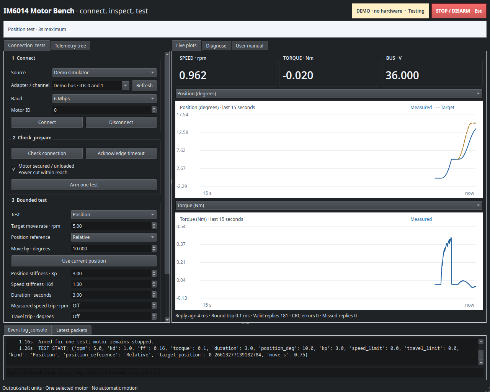

# IM6014 Motor Bench

Linux desktop dashboard for connecting, diagnosing and testing a Unitree IM6014 actuator over USB/RS-485. Uses a moteus tview-style layout with connection controls, telemetry, live plots and an event/packet console.



## Install and start

```bash
git clone https://github.com/sidrk-dev/im6014Development.git
cd im6014Development
python3 -m venv .venv
source .venv/bin/activate
python3 -m pip install -r requirements.txt
./start_dashboard.sh
```

Start without hardware using `./start_dashboard.sh --demo`. Both modes start disconnected and disarmed. The launcher finds the application relative to its own location.

## Controls

- **Speed:** signed output-shaft rpm, with acceleration/deceleration ramps and friction compensation. No fixed 5 rpm cap; protocol bounds still apply.
- **Position:** relative or absolute angles in degrees, smooth target movement, adjustable Kp/Kd, and holding until the test duration ends.
- **Torque pulse and damping:** short torque tests or resistance to manual motion.
- **Diagnostics:** valid-reply counters, CRC/deadline errors, decoded faults, individual-ID Stop/status discovery, and JSON/CSV exports.
- **Stop/disarm:** priority button or Esc. Each motion test requires a fresh arm action. Optional measured-speed and travel trips default to Off.

Read the [user manual](USER_MANUAL.md) for setup, units, commissioning steps and recovery. All displayed motion quantities use output-shaft units, converted using the exact 38/3 reduction.

## Hardware and validation

The recorded unloaded bench test used motor ID 0, 6 Mbps, and the supplied FTDI FT4232H adapter's Channel D. Device paths are machine-specific; select your adapter in the app.

The earlier physical test achieved a measured 5.002 rpm average and confirmed Stop afterward. Higher-speed and position changes have been tested offline only. Detailed bench records and validation reports remain in the original local workspace.

Use a secured, unloaded motor with power isolation within reach. Stop releases torque and can let a gravity-loaded joint fall. The dashboard retains firmware/host watchdogs and fault, voltage, temperature and measured-torque checks; it is not a safety-rated controller or a commissioned robot-arm controller.

## Offline checks

With the virtual environment active:

```bash
python3 test_spin_5rpm.py
QT_QPA_PLATFORM=offscreen python3 test_dashboard.py
```

These checks use packet fixtures and simulated serial devices, without opening a physical motor port. The dashboard check writes screenshots and a result summary into the project folder.

## Repository contents

This source repository contains the desktop application, shared packet codec, serial-session worker, launcher, dependency file, user manual, offline tests and a simulator screenshot. The dashboard does not require vendor archives to run.

Vendor ZIPs and extracted files, archive inspection tools/reports, machine-specific shortcuts, hardware logs and generated JSON results stay local and are excluded from Git. Historical evidence-file references in the manual refer to that original workspace. No archived executables or firmware are uploaded or run.
