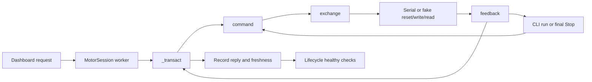

# B01-B10 source trace and verification obligations

## Overview

The current communication boundary is `spin_5rpm.py`. It owns command encoding, CRC, strict feedback decoding, health checks, and one synchronous request/reply exchange. `MotorSession` owns the dashboard's serial connection and calls those functions. The standalone CLI is a separate, alternative serial owner. This matches the dependency map in [architecture.md](/home/sid/Documents/code/im6014Workbench/docs/architecture.md:13).

This report describes the inspected source before B implementation, at repository HEAD `c5132702a164e4f2f611e30de914f24d8d52739a`. The inspected SHA256 values were `d5909eb112b6237002b6f6be4dd4629fef54fcc9dccdff007639ec8bda4a9581` for `spin_5rpm.py`, `7da77ff879f1dea39b6906ef71f614268ca9222803badb7b101e09739c5617a3` for `motor_session.py`, and `492219a27c2d243e3650beec88075d4a1a9e734d8414a9b7b99abbe952cc9277` for `test_spin_5rpm.py`. This was a read-only source inspection. No tests, package operations, hardware I/O, Git mutations, or checkout edits were performed.

## Key concepts

- `command()` is a pure encoder. It returns exactly 20 bytes and does not open or write a port. `feedback()` accepts exactly one 26-byte response and returns a mutable dictionary. `healthy()` applies bench operating limits after decoding. See [spin_5rpm.py](/home/sid/Documents/code/im6014Workbench/spin_5rpm.py:34).
- `exchange()` assumes one bus owner and one outstanding transaction. It resets buffered input, writes the supplied bytes, then waits for a response. It does not acquire an ownership lock. See [exchange()](/home/sid/Documents/code/im6014Workbench/spin_5rpm.py:81).
- `MotorSession._transact()` encodes a request, calls the imported `exchange` name, and records validated feedback. Lifecycle checks and Stop attempts sit above the packet layer. See [_transact()](/home/sid/Documents/code/im6014Workbench/motor_session.py:185).
- Motor-output units use the internal reduction `38/3`. The existing API exposes rpm, radians, and Nm. A future external joint reduction belongs outside this boundary, as required by [the plan](/home/sid/Documents/code/im6014Workbench/docs/ROBOT_WORKBENCH_AGENT_PROMPT.md:204).

## Runtime flow

### Encoding and decoding

`command()` checks individual ID 0-14, Stop/FOC modes, finite values, protocol position/speed ranges, and current bench gain/torque limits. Stop requires zero targets, and FOC requires the watchdog. The command begins with `fe ee`, then packs ID, mode, and watchdog into one byte, followed by a zero byte and `<hhihh>` control fields. It appends a little-endian CRC over the first 16 bytes. See [command()](/home/sid/Documents/code/im6014Workbench/spin_5rpm.py:34).

`crc32()` processes complete four-byte words, reversing byte order within each word before applying polynomial `0x04c11db7` from initial value `0xffffffff`. Command CRC covers its header and payload. Feedback CRC covers the 20-byte body at offsets 2-21, excluding its `fc ee` header. See [crc32()](/home/sid/Documents/code/im6014Workbench/spin_5rpm.py:22) and [feedback()](/home/sid/Documents/code/im6014Workbench/spin_5rpm.py:55).

`feedback()` first rejects a wrong length or header, then a CRC mismatch, then a wrong requested ID or unsupported reported mode. It unpacks `<BbBBhhiIHBB>`. Driver temperature, torque, speed, and position are signed. Winding temperature, voltage, error bits, and flags are unsigned. It reports timeout from bit 7 of the packed ID/mode byte and warnings from flag bits 13-15. The final two body bytes are unpacked and ignored. The result retains the full original response as hexadecimal `raw`.

The output conversions are `rpm = speed_raw * 60 / (64 * (38/3))` and `position_rad = position_raw * 2*pi / (32768 * (38/3))`. Command conversion applies the inverse before rounding. Torque and gains also apply the internal reduction. Keep the meaning of existing fields and constants when extracting the boundary. Changing feedback velocity to rad/s would require changing callers and exported data, so it is outside B10 compatibility work.

### Exchange and stream handling

The current `exchange()` calls `reset_input_buffer()` before it starts its clock. It then writes once and rejects any return value other than the full packet length. Its loop reads at most 26 bytes per call using `in_waiting`, appends bytes to a local bytearray, finds the first `fc ee`, and submits the first complete 26-byte candidate to `feedback()`. It checks the clock again before decoding. See [exchange()](/home/sid/Documents/code/im6014Workbench/spin_5rpm.py:81).

This already handles ordinary prefix noise and a frame delivered one byte at a time. It does not resynchronize after a false header, corrupt candidate, unsupported mode, or another motor's frame. The decoder exception escapes immediately. A valid requested response later in the same stream is never examined. The accumulation buffer can also grow for the whole transaction when no valid header appears.

Keep a strict single-frame decoder and a separate stream policy. The decoder must reject an oversized argument, while the exchange must allow noise or several frames in a stream. Accepting a valid 26-byte candidate from a larger stream does not mean the decoder accepts oversized packets. Advancing one byte after a rejected candidate permits an overlapping header inside it to be found. Retaining only a trailing `fc` when no header exists preserves a header split across reads and bounds the scan buffer.

There is no request sequence number in the response. Clearing buffered input cannot prove that a later arriving reply was caused by the current request. One owner, one outstanding exchange, ID checks, mode checks, and time bounds reduce ambiguity. They do not establish request/reply correlation beyond what the protocol carries.

### Dashboard ownership and freshness

Construction starts the `IM6014 serial owner` worker with `bus=None`. A queued Connect selects `DemoSerial` or constructs pyserial with `port=None`, 5 ms read timeout, 50 ms write timeout, and exclusivity, then opens the selected port. Connect invokes `_check()`, which sends Stop/status packets. Connected idle polling also sends Stop/status every approximately 50 ms. These are control operations, as the [baseline audit](/home/sid/Documents/code/im6014Workbench/docs/bench-baseline.md:19) records.

`_transact()` increments TX before exchange, so TX counts attempted requests. Only a returned validated dictionary increments RX. Only a reply for the session's selected ID updates `last_reply`, `latest`, and samples. Scan exchanges for another explicitly requested ID increment RX without refreshing the selected motor. See [freshness recording](/home/sid/Documents/code/im6014Workbench/motor_session.py:185) and [scan](/home/sid/Documents/code/im6014Workbench/motor_session.py:338).

Health validation happens after freshness recording. A CRC-valid correct-ID response carrying a fault can become `latest` before `healthy()` raises. That is deliberate evidence of the reported fault, and must be distinguished from accepting another motor as fresh state. The protocol decoder validates framing and identity; it does not apply the bench health policy.

FOC startup permits the first zero-target reply to report the previous mode, then requires mode 1 on the second reply. `_stop()` likewise retries once if feedback still reports mode 1. Preserve this caller assumption. See [test start](/home/sid/Documents/code/im6014Workbench/motor_session.py:331), [Stop](/home/sid/Documents/code/im6014Workbench/motor_session.py:214), and [CLI arming](/home/sid/Documents/code/im6014Workbench/spin_5rpm.py:117).

### Failure propagation

`command()` failures are `ValueError`. The worker treats these as rejected requests without calling `_fault()`. Feedback and exchange failures are `RuntimeError`; the worker faults and disarms, attempts Stop, and leaves the fault latched. `InterruptedError` takes a separate Stop path. Preserve the distinction when introducing exception classes. A communication exception changed to `ValueError` would become a request rejection and skip the current fault/Stop behavior. See [worker dispatch](/home/sid/Documents/code/im6014Workbench/motor_session.py:399).

`_transact()` classifies counters by the substrings `CRC` and `deadline`. Scan suppresses only `RuntimeError` messages containing `deadline`. If a scanner skips bad candidates and ultimately times out, retain enough error classification to keep CRC faults observable. Define whether a corrupt candidate followed by a valid response counts as a recovered CRC error. The current wrapper cannot count that event if exchange returns success without metadata. See [_transact()](/home/sid/Documents/code/im6014Workbench/motor_session.py:194) and [scan exceptions](/home/sid/Documents/code/im6014Workbench/motor_session.py:349).

`_stop()` catches its own failures and returns false. `_fault()` still latches the original fault after that attempt. Idle Stop polling continues on an open bus, and restored feedback cannot restart a test. The CLI catches run/open failures, then tries three final Stop exchanges, closes the port, writes its log, and exits unsuccessfully if the run or Stop confirmation failed. A failed first final exchange aborts that cleanup loop. These are existing lifecycle semantics, not proof that torque is off. See [_fault()](/home/sid/Documents/code/im6014Workbench/motor_session.py:231) and [CLI cleanup](/home/sid/Documents/code/im6014Workbench/spin_5rpm.py:183).

## Concrete B01-B10 gaps

The required pass conditions are in [the milestone table](/home/sid/Documents/code/im6014Workbench/docs/ROBOT_WORKBENCH_AGENT_PROMPT.md:295).

| Milestone | Existing evidence and gap | Minimum new verification |
| --- | --- | --- |
| B01 | Encoder is still in the CLI module. Existing Stop hexadecimal and control-word fixtures are useful. | Extract or wrap without changing the callable signature or output. Run the inherited fixtures against the compatibility import and extracted encoder. |
| B02 | `frame()` generates its body and CRC using production code. Assertions cover only voltage, winding temperature, and position sign. It is not a captured motor packet. | Use a fixed response with independent expected values for every returned field. Record provenance separately. If no real capture is available, report physical capture pending rather than relabeling a synthetic frame. |
| B03 | One altered payload byte is rejected. Checksum corruption and independent CRC agreement are not fully covered. | Mutate each relevant payload and checksum byte of a fixed frame and require rejection. Include independently sourced fixed CRC values. |
| B04 | Direct decoding rejects all lengths except 26, but the tests cover one short input only. | Check short lengths, an oversized frame, unrelated headers, and correctly checksummed unsupported mode/ID cases. Verify stream noise does not weaken the single-frame API. |
| B05 | `FakeSerial` emits one fixed response, does not record writes, and only has a partial-write switch. `TrackedDemo` records writes but its response behavior is tied to toy motor dynamics. | Add a reusable scripted transport with exact write records, selectable chunks, empty reads, injected errors, stale buffered input, write counts, and time behavior. |
| B06 | Existing exchange fixture gives one byte per read and passes ordinary fragmentation. | Preserve that case and add header/CRC split boundaries, empty reads between chunks, and exhaustion before a full response. |
| B07 | Ordinary `noise` prefix is covered. A header-shaped noise prefix or rejected complete candidate terminates the exchange. | Require recovery after a false header, corrupt candidate, and overlapping header when followed by a valid requested response. Bound retained noise. |
| B08 | Decoder rejects a wrong ID, but no fixture proves session freshness remains unchanged. | Wrong-ID-only input must not return requested feedback or refresh the selected motor. If recovery is supported, wrong-ID then requested-ID input returns only the requested frame. Check scan's intentional freshness exception. |
| B09 | A 2 ms missing-response test requires an exception without checking elapsed time. Reset is outside the deadline; serial calls can exceed the remaining budget. | Check deterministic timing, write budget, remaining read budget, late complete response rejection, and timeout restoration on success and every exception. Add a parent-run pyserial pseudo-terminal check for real missing-response bounds. |
| B10 | Encoding tests have useful signed raw constants and extrema. Decoder tests do not independently verify speed or exact position conversions. | Use independent literal raw values and expected output units in both signs, zero, and endpoint cases. Assert internal reduction is applied once and external reduction is absent. |

The inherited fixture locations are [test_spin_5rpm.py](/home/sid/Documents/code/im6014Workbench/test_spin_5rpm.py:16) and [its transport fake](/home/sid/Documents/code/im6014Workbench/test_spin_5rpm.py:56). Useful independently derived decoder cases include speed raw `608` producing exactly `45 rpm`, and position raw `311296` producing `3*pi/2 radians`, with signed counterparts. Derive expected values without importing the production ratio or conversions.

## Deadline and fake requirements

A monotonic loop condition alone bounds polling between calls. It cannot interrupt a blocking method. The current 5 ms read timeout can exceed a 2 ms exchange budget. A write may consume its configured 50 ms even when the requested transaction budget is shorter. Reset and `in_waiting` access have their own behavior. The existing fake returns immediately and does not expose these cases.

For supported pyserial-style transports, start the clock at the defined transaction boundary, cap write/read timeouts to the remaining budget, check elapsed time after calls, and restore original timeouts in `finally`. Reject completion at or after expiry. Document reset/property access assumptions explicitly. A synchronous call that ignores its configured timeout cannot be made bounded by checking the clock afterward; tests and public claims must state that transport contract. Avoid adding an unbounded `flush()`.

The fake needs the same mutable timeout attributes used by production, including `write_timeout`. Both existing fakes have `timeout` but lack `write_timeout`, as shown in [DemoSerial](/home/sid/Documents/code/im6014Workbench/motor_session.py:66) and [FakeSerial](/home/sid/Documents/code/im6014Workbench/test_spin_5rpm.py:56). Fake reads must obey the requested size and advance a shared fake monotonic clock when empty input waits. Script partial writes and reset/read/write failures. Observe timeout assignments and restoration rather than merely asserting an exception. The plan explicitly calls for [fake clocks and deterministic deadline tests](/home/sid/Documents/code/im6014Workbench/docs/ROBOT_WORKBENCH_AGENT_PROMPT.md:683).

Keep the dynamics demo separate from protocol fixtures unless it gains only the transport attributes needed for compatibility. Its hard-coded `in_waiting=26`, old-mode reply, timeout latch, and `fault`/`crc`/`timeout` injection underpin the lifecycle suite. [TrackedDemo](/home/sid/Documents/code/im6014Workbench/test_dashboard.py:69) records owner-thread names, and [lifecycle checks](/home/sid/Documents/code/im6014Workbench/test_dashboard.py:92) assert that all writes belong to the worker and failures stay disarmed.

## Compatibility and evidence integration

Preserve `spin_5rpm.command`, `feedback`, `crc32`, `exchange`, `healthy`, `PORT`, `RATIO`, and range constants as existing import points. Preserve dictionary keys and mutable return behavior. The CLI appends fields directly, and the session appends timestamps, targets, and provenance. [motor_session.py](/home/sid/Documents/code/im6014Workbench/motor_session.py:15) imports function objects into its own namespace. Patching `spin_5rpm.exchange` after that import does not replace `motor_session.exchange`.

The actual guarded patch points are `motor_session.DemoSerial` and `motor_session.serial.Serial` in [test_dashboard.py](/home/sid/Documents/code/im6014Workbench/test_dashboard.py:92), plus `motor_session.exchange` in [the startup verifier](/home/sid/Documents/code/im6014Workbench/test_startup.py:230). Keep `_transact()` calling that module-level name or update the sentinels deliberately. Moving its call directly to a new module would silently weaken the startup guard if the verifier stayed unchanged.

The offline driver copies a fixed list of eight files into isolated temporary storage before running checks. Any extracted runtime module, shared fixture, or B test must join its copy list, and the B check needs a logged execution entry. See [check_offline_baseline.sh](/home/sid/Documents/code/im6014Workbench/scripts/check_offline_baseline.sh:81). The [startup receipt source list](/home/sid/Documents/code/im6014Workbench/test_startup.py:113) also needs the new runtime files so its identity includes the actual boundary. Existing UI and startup checks remain required compatibility evidence, with screenshots inspected by the parent.

The parent records actual per-milestone results, source identity, evidence paths, review, and remaining dependencies in the ledger. Fixed packets, fake transport, pseudo-terminal serial timing, and any separately authorized motor capture require distinct provenance. B software evidence cannot establish physical communication or torque-off.

## Summary

The codec already enforces useful framing, CRC, identity, and bench-unit rules. The main implementation gaps are reusable controllable transport fixtures, recovery after rejected stream candidates, and a deadline that covers supported serial waits. Preserve the CLI/session APIs, failure categories, startup monkeypatch points, demo mode-transition behavior, and offline copy/hash identities. Parent-run deterministic B checks, existing product checks, and a bounded pyserial timing check can establish the software result; captured physical packets need their own evidence.
