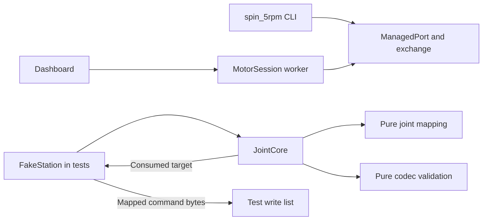

# How the controller works and what C07-C16 must add

Inspected checkout `1be64b2b27f48d16a3b5fdcdd0ae278262a447f1`, with the B11-C06 controller baseline from `244811b`. Both complete explorer reports and both rationale reports were read. This synthesis checked claims against source; it ran no tests and made no implementation, Git, hardware or network changes.

## Existing architecture

The workbench currently has two separate control paths. The dashboard creates a `MotorSession` worker, and the CLI runs `spin_5rpm.run`. Both use actuator output units and acquire the same cooperating device lease. Separately, `JointCore` provides an ordered multi-joint request contract. Neither bench entry point currently calls it. `FakeStation` in the tests demonstrates how an adapter can turn core decisions into packet writes. [Architecture:17](/tmp/pstack-c07-c16-20261008-smgcfm_v/workbench/docs/architecture.md:17), [CLI:37](/tmp/pstack-c07-c16-20261008-smgcfm_v/workbench/spin_5rpm.py:37), [FakeStation:25](/tmp/pstack-c07-c16-20261008-smgcfm_v/workbench/test_controller.py:25).

The intended integration uses one station process to own the physical bus and refresh loop. Clients submit requests to it. The selection and later plan support treating the earlier daemon rejection as a B11-C06 scope deferral. The later plan explicitly requires a station process, while its IPC protocol and scheduling remain undecided. Keep `JointCore` thread confined and transport free when adding that process. [Plan:210](/tmp/pstack-c07-c16-20261008-smgcfm_v/workbench/docs/ROBOT_WORKBENCH_AGENT_PROMPT.md:210), [selection:7](/tmp/pstack-c07-c16-20261008-smgcfm_v/workbench/docs/controller-design.md:7), [core contract:16](/tmp/pstack-c07-c16-20261008-smgcfm_v/workbench/docs/controller-design.md:16).

The diagram shows current paths. A production station connecting `JointCore` to transport is proposed work.

## Core lifecycle and target flow

`JointSpec` binds each unique name and motor ID to a `JointMap`. Construction fixes their order, creates empty observations, and starts disconnected with sequence watermark `-1`. Frozen records separate current observations, attributed fault causes, targets and snapshots. `SourceIdentity` records declared backend, identity and connection; it does not establish motion authority. [Types:69](/tmp/pstack-c07-c16-20261008-smgcfm_v/workbench/joint_controller.py:69), [source:150](/tmp/pstack-c07-c16-20261008-smgcfm_v/workbench/joint_controller.py:150), [initialization:294](/tmp/pstack-c07-c16-20261008-smgcfm_v/workbench/joint_controller.py:294).

The caller drives `begin_connect`, `connected`, `begin_check`, per-joint `receive`, `checked`, then `arm`. Each valid observation gets the core's monotonic receive timestamp. Check and arm require every active joint to have fresh, healthy, Stop-mode feedback. Unknown IDs never refresh another joint. The default 0.5-second age threshold is a policy, not a communication-rate measurement. [Lifecycle:410](/tmp/pstack-c07-c16-20261008-smgcfm_v/workbench/joint_controller.py:410), [receipt:438](/tmp/pstack-c07-c16-20261008-smgcfm_v/workbench/joint_controller.py:438), [check and arm:496](/tmp/pstack-c07-c16-20261008-smgcfm_v/workbench/joint_controller.py:496).

`submit_target` requires ARMED or MOVING, fresh healthy observations, and a complete tuple matching the configured order. It maps every joint and calls the pure codec to validate representability and existing bench bounds. It discards those bytes. Only after all payload checks does it enforce a strictly newer uint64 sequence and replace the one pending slot. Invalid replacements retain both pending target and watermark. [Target:217](/tmp/pstack-c07-c16-20261008-smgcfm_v/workbench/joint_controller.py:217), [submission:552](/tmp/pstack-c07-c16-20261008-smgcfm_v/workbench/joint_controller.py:552).

`consume_target` calls `tick`, refuses unhealthy or faulted execution, removes the pending target once, and sets logical MOVING before returning it. Consumption proves neither transmission nor motor movement. `FakeStation.consume` separately maps and encodes the returned target into its write list. [Consumption:592](/tmp/pstack-c07-c16-20261008-smgcfm_v/workbench/joint_controller.py:592), [adapter:59](/tmp/pstack-c07-c16-20261008-smgcfm_v/workbench/test_controller.py:59).

Unhealthy telemetry and communication failures latch causes per joint and clear pending motion. `tick` faults stale READY, ARMED or MOVING observations. Stop clears pending but preserves faults; disconnected/connecting Stop rejects. Reconnect invalidates observations while preserving faults and ordering. Recovery requires explicit acknowledgment, new healthy Stop observations from every joint, and successful `checked`. Healthy feedback alone cannot clear the latch. [Fault accumulation:355](/tmp/pstack-c07-c16-20261008-smgcfm_v/workbench/joint_controller.py:355), [tick:529](/tmp/pstack-c07-c16-20261008-smgcfm_v/workbench/joint_controller.py:529), [Stop and disconnect:604](/tmp/pstack-c07-c16-20261008-smgcfm_v/workbench/joint_controller.py:604).

Two subtleties matter for callers. An accepted `receive` or `tick` can leave the core in FAULT because acceptance describes processing the event. `snapshot` computes ages without performing a tick, so a snapshot alone does not enforce freshness. [Receipt:459](/tmp/pstack-c07-c16-20261008-smgcfm_v/workbench/joint_controller.py:459), [tick result:550](/tmp/pstack-c07-c16-20261008-smgcfm_v/workbench/joint_controller.py:550), [snapshot:621](/tmp/pstack-c07-c16-20261008-smgcfm_v/workbench/joint_controller.py:621).

## Mapping, transport and ownership boundaries

`JointMap` applies external reduction once: `q_out=q0+s*N*q`, `dq_out=s*N*dq`, `tau_out=s*tau/N`, and gains divide by `N²`. It converts output velocity to rpm and reverses feedback into joint rad, rad/s and Nm. The codec owns the internal `38/3` reduction, integer encodings and word-reversed CRC. Mapping rejects numerical failures and never clips values to evade codec rejection. Compatible gain definitions and measured effort meaning remain physical assumptions requiring verification. [Mapping:64](/tmp/pstack-c07-c16-20261008-smgcfm_v/workbench/joint_mapping.py:64), [codec:4](/tmp/pstack-c07-c16-20261008-smgcfm_v/workbench/im6014_codec.py:4), [API assumptions:15](/tmp/pstack-c07-c16-20261008-smgcfm_v/workbench/docs/joint-api.md:15).

C13's candidate prediction is `tau_ff + kp*(q_ref-q_measured) + kd*(dq_ref-dq_measured)`, using consistent coordinates and rad/s. The archived formula describes rotor quantities; its Kp unit label has a documented dimensional error. These conventions must be resolved before treating predictions as physically verified. [Formula:9](/home/sid/.codex/skills/unitree-im6014/references/official/en/Control_Mode.md:9), [unit correction:22](/home/sid/.codex/skills/unitree-im6014/references/development-notes.md:22).

`open_managed_port` checks passive metadata, obtains the character-device lease before constructing serial, then verifies the opened descriptor against `st_rdev`. Aliases collide in a fixed private per-user namespace. Lockfiles persist to preserve inode identity. Known adapter mismatches reject; incomplete passive metadata can remain unverified and still permit opening. `ManagedPort.verified` confirms device-descriptor identity, not motor communication. [Opening:235](/tmp/pstack-c07-c16-20261008-smgcfm_v/workbench/im6014_port.py:235), [lease:173](/tmp/pstack-c07-c16-20261008-smgcfm_v/workbench/im6014_port.py:173), [inspection:386](/tmp/pstack-c07-c16-20261008-smgcfm_v/workbench/im6014_port.py:386).

`ManagedPort.close` returns False and retains its retryable lease when closure is unconfirmed. Confirmation requires the exact boolean `is_open is False`; context exit raises `PortCloseError` on failure. The lease excludes cooperating callers only. `exchange` resets input once, writes once, scans for validated requested-ID feedback, and restores timeout settings. Its deadline assumes the driver's synchronous calls honor their contracts; it cannot interrupt a hung kernel call. Optional `PacketCapture` keeps bounded allowlisted diagnostic records. [Close:81](/tmp/pstack-c07-c16-20261008-smgcfm_v/workbench/im6014_port.py:81), [exchange:321](/tmp/pstack-c07-c16-20261008-smgcfm_v/workbench/im6014_serial.py:321), [capture:222](/tmp/pstack-c07-c16-20261008-smgcfm_v/workbench/im6014_serial.py:222).

The physical lease, `MotorSession.generation`, and C08 ownership are distinct. GUI Stop increments a local job generation and discards older queued jobs. It does not authenticate policy requests or revoke a motion owner. The GUI worker lives inside the dashboard process and therefore cannot demonstrate process independence. [GUI generation:179](/tmp/pstack-c07-c16-20261008-smgcfm_v/workbench/motor_session.py:179), [worker loop:475](/tmp/pstack-c07-c16-20261008-smgcfm_v/workbench/motor_session.py:475).

## Required additions and unresolved design choices

These are requirements from the plan, not existing behaviors. [Milestones:328](/tmp/pstack-c07-c16-20261008-smgcfm_v/workbench/docs/ROBOT_WORKBENCH_AGENT_PROMPT.md:328).

| Unit | Required behavior | Decision still needed |
| --- | --- | --- |
| C07 | Expired commands never reach dispatch. | Time representation, boundary equality, expired-pending disposal and result reporting. Submission-only validation cannot cover later expiry. |
| C08 | Reject earlier-owner commands; human takeover revokes automation and clears pending actions. | Authority token, takeover/reconnect semantics and explicit sequence-stream rules. Current connection identity supplies no authority check. |
| C09 | Enforce documented joint position limits, including boundaries. | Limit configuration and rejection or shaping policy. Codec representability is not a workcell travel limit. |
| C10 | Bound the reference position change by configured velocity. | Reference state, elapsed-time handling and limiting method. Checking requested `dq` alone cannot bound a position jump. |
| C11 | Bound reference velocity changes by configured acceleration. | Initial conditions, zero/regressing time and integration semantics. Blanket target rejection is not prescribed. |
| C12 | Bound requested-position lead over measured position. | Rejection or shaping, feedback validity and interaction with velocity/acceleration limiting. |
| C13 | Consider combined feedforward, stiffness and damping effort and monitor effort. | Verified units, observation meaning, conservative limits and response. The codec's ±3.5 Nm feedforward bound does not bound combined effort. |
| C14 | New targets cannot clear temperature or persistent-effort faults. | Additional observations and persistent-condition recovery guards. `MotorHealth` currently has only mode, masks and timeout. |
| C15 | Report actual loop period, transaction latency, overruns and feedback age. | Measurement location, definitions and provenance. Core ages and capture timestamps exist; station-loop metrics do not. |
| C16 | Dashboard failure creates neither a second owner nor automatic rearm. | Station/client lifetime, IPC, supervision and reconnection rules. Fake process failure must exercise ownership and authority, not merely separate core instances. |

Preserve bounded complete immutable requests, full mapped codec validation, per-joint freshness, attributed fault latches, confirmed-close ownership and existing bench behavior. Specify ordering explicitly if C08 introduces a new stream; reconnect currently never resets the watermark. Keep requested, accepted after limiting, actually dispatched and measured records separate. [Existing target contract:68](/tmp/pstack-c07-c16-20261008-smgcfm_v/workbench/docs/joint-api.md:68), [four records:165](/tmp/pstack-c07-c16-20261008-smgcfm_v/workbench/docs/ROBOT_WORKBENCH_AGENT_PROMPT.md:165), [takeover:229](/tmp/pstack-c07-c16-20261008-smgcfm_v/workbench/docs/ROBOT_WORKBENCH_AGENT_PROMPT.md:229).

## Reconciled gotchas and execution constraints

- The dashboard timer is **100 ms**, calls `refresh`, and pings the session on the GUI event loop. The explorer's 50 ms/off-thread heartbeat description is incorrect. The worker's existing 0.5-second GUI-loss rule is bench policy, not a mandated C16 timeout. [Timer:138](/tmp/pstack-c07-c16-20261008-smgcfm_v/workbench/motor_dashboard.py:138), [refresh:471](/tmp/pstack-c07-c16-20261008-smgcfm_v/workbench/motor_dashboard.py:471), [heartbeat:434](/tmp/pstack-c07-c16-20261008-smgcfm_v/workbench/motor_session.py:434).
- Expired incoming replacements must not corrupt valid pending state. An accepted pending target that later expires cannot remain dispatchable. The reports' blanket preservation claim leaves that distinction unresolved. Rejection versus reference shaping, continuous/peak thresholds and snapshot metric placement are proposals, not selected contracts.
- No inspected measurement supports the explorer's 1-2 ms six-motor cycle estimate. Raw packet wire time excludes USB turnaround, firmware, scheduling and cleanup. The plan requires measuring achievable rate. [Rate requirement:223](/tmp/pstack-c07-c16-20261008-smgcfm_v/workbench/docs/ROBOT_WORKBENCH_AGENT_PROMPT.md:223).
- The copyset and startup fingerprint enumerate files explicitly. New modules and checks must enter both and the relevant test invocation; omission is not automatically detected merely because a file was added. [Copyset:81](/tmp/pstack-c07-c16-20261008-smgcfm_v/workbench/scripts/check_offline_baseline.sh:81), [fingerprint:112](/tmp/pstack-c07-c16-20261008-smgcfm_v/workbench/test_startup.py:112).
- Timeout acknowledgment remains physically unresolved. Current bench code attempts explicit Stop-mode acknowledgment, while archived documents disagree about clearing it. A fake receipt cannot resolve firmware behavior. [Bench acknowledgment:323](/tmp/pstack-c07-c16-20261008-smgcfm_v/workbench/motor_session.py:323), [archive discrepancy:26](/home/sid/.codex/skills/unitree-im6014/references/development-notes.md:26).

The current workflow requires fake I/O and PTYs, one isolated writer per milestone, and parent-owned tests, Git and hardware decisions. Physical Stop, effort protection, calibrated units and loaded-arm shutdown remain unverified. Predicted effort is an additional control check and cannot establish certified actuator protection. The rationale reports also flag a missing retained PR body; their history does not establish a real double-owner incident. [Workflow:35](/tmp/pstack-c07-c16-20261008-smgcfm_v/workbench/docs/c07-c16-workflow.md:35), [hardware boundary:51](/tmp/pstack-c07-c16-20261008-smgcfm_v/workbench/docs/c07-c16-workflow.md:51), [physical limits:58](/tmp/pstack-c07-c16-20261008-smgcfm_v/workbench/docs/controller-design.md:58), [effort boundary:339](/tmp/pstack-c07-c16-20261008-smgcfm_v/workbench/docs/ROBOT_WORKBENCH_AGENT_PROMPT.md:339).
