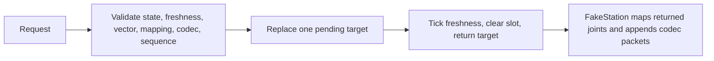

# Controller grounding for C07-C10

## Overview

Checkout inspected: `/home/sid/Documents/code/im6014Development/.worktrees/controller-c07-c10`. All references below are relative to that checkout, with one-based lines. This pass read source and computed hashes. It ran no tests, production imports, package installs, Git writes, or hardware I/O. Only this report was written.

`JointCore` is transport-free and thread-confined, `joint_controller.py:1`. It currently stores one immutable target and returns it once. Its only callers are offline controller tests. The GUI and CLI remain separate bench owners, `docs/architecture.md:17`, `:21`, `:29`. A Python/shell search found no production caller of `joint_controller`. The ledger ends at C06, `docs/milestones.tsv:31`, with historical parent-run evidence. C07-C10 acceptance requirements are `docs/ROBOT_WORKBENCH_AGENT_PROMPT.md:328` through `:331`; acceleration, measured-position lead, effort, further fault behavior, timing, and station independence remain C11-C16, `:332` through `:337`.

## Key concepts

`JointSpec` fixes name, motor ID, and external mapping but has no position/velocity limits, `joint_controller.py:70`. `JointTarget` carries joint radians, radians/second, effort, and gains, `joint_mapping.py:110`; its constructor requires finite values and nonnegative gains, `:117`. `Target` has only an unsigned 64-bit sequence and nonempty tuple of JointTarget, `joint_controller.py:218`. It has no creation time, expiry, command source, or ownership generation. `SourceIdentity` describes feedback backend/connection, `:151`; it is not motion ownership.

`Snapshot` exposes immutable observations, ages, faults, pending target, and watermark, `joint_controller.py:234`. Snapshot creation reads time but does not expire pending commands or latch stale feedback, `:621`. `_pending_target` is one slot; `_last_sequence` begins at -1 and persists for the core lifetime, `:337`.

## How it works

Submission requires ARMED/MOVING, complete fresh healthy feedback, and correct vector length, `joint_controller.py:552`. Freshness is inclusive at its configured deadline, `:402`. Every joint is externally mapped and passed to pure `command` with mode 1 and watchdog enabled, `:569`. Any mapping/codec ValueError rejects the complete request, `:582`. Only after full-vector validation does sequence rejection occur; successful submission replaces one pending target and advances the watermark, `:585`. Submission emits no fake packet, asserted at `test_controller_targets.py:272`.

Consumption requires ARMED/MOVING and invokes `tick` before returning anything, `joint_controller.py:592`. A fault suppresses the return. Otherwise it clears pending and returns that exact target once, entering MOVING, `:598`. There is no active-goal storage, last-reference record, dispatch timestamp, or interpolation. A second consume returns None while state remains MOVING, `test_controller_targets.py:58`. `FakeStation.consume` is the only dispatch adapter, `test_controller.py:59`; it maps returned `.joints` and encodes mode-1 bytes into an in-memory list, `:62`. The independently calculated expected-packet test covers directions, external ratios, offsets, velocity, effort, and gains, `test_controller_targets.py:252`.

`JointMap.to_output` applies offset plus signed reduction to position, signed reduction to velocity/RPM, inverse reduction to effort, and inverse reduction squared to gains, `joint_mapping.py:64` through `:83`. `from_output` reverses that mapping, `:85`. Apply new limits in joint coordinates before external conversion; internal motor reduction stays in the codec.

Lifecycle is DISCONNECTED, CONNECTING, CONNECTED, CHECKING, READY, ARMED, MOVING. Check starts only from CONNECTED/STOPPED/FAULT and needs acknowledgment for stored faults, `joint_controller.py:426`. It clears observations/pending but retains causes. Completing Check requires every fresh healthy joint in mode 0 and then clears causes, `:496`; Arm repeats that gate, `:512`. Unhealthy feedback and communication failures accumulate bounded per-joint causes and latch FAULT, `:355`, `:459`, `:470`. The latch clears pending, `:381`. `tick` latches stale joints only in READY/ARMED/MOVING and can return an accepted Decision while entering FAULT, `:529`. Healthy packets do not clear stored causes.

Stop clears pending and enters STOPPED unless a fault exists, `joint_controller.py:604`. Disconnect clears source, observations, and pending but retains fault causes/watermark, `:614`. Recovery requires an acknowledged fresh mode-0 Check then separate Arm. None of these core methods sends packets. FakeStation writes mode-0 packets only after accepted Stop, `test_controller.py:78`.

## Every call site affected by replacing Target

Only `test_controller.py:6` and `test_controller_targets.py:5` import this contract. Dashboard Target display text and `arm_dashboard.py`'s separate HTTP watermark do not use it. Internal type/storage sites are `joint_controller.py:218`, `:242`, `:281`, `:337`, `:552`, `:564`, `:588`, `:592`, `:638`; clearing sites are `:381`, `:434`, `:599`, `:607`, `:618`. New active-goal/reference storage must follow those reset paths.

`test_controller.py` constructs Target at `:271` in `core_at`'s MOVING fixture, directly submits at `:57`, `:275`, consumes at `:60`, `:276`, and reads returned `.joints` at `:62`. The MOVING fixture consumes without advancing the clock, so changing initial-reference behavior requires migrating it.

All 47 Target constructors in `test_controller_targets.py` are at lines 37, 75, 78, 86, 88, 128, 142, 143, 152, 159, 166, 173, 189, 216, 220, 227, 245, 267, 313, 315, 325, 335, 382, 410, 440, 479, 485, 492, 500, 508, 526, 538, 548, 575, 577, 583, 588, 595, 602, 607, 621, 669, 675, 683, 689, 710, 727. Metadata must be supplied even in tests rejecting another field.

| Call in `test_controller_targets.py` | All call lines |
| --- | --- |
| `submit_target` | 135, 146, 153, 160, 167, 174, 221, 228, 244, 428, 433, 444, 710 |
| `consume_target` | 429, 436, 447 |
| FakeStation `submit` | 44, 104, 129, 190, 217, 269, 316, 322, 326, 336, 345, 363, 386, 480, 486, 493, 501, 509, 527, 531, 539, 543, 549, 584, 589, 596, 604, 608, 622, 664, 670, 676, 684, 690, 728 |
| FakeStation `consume` | 53, 58, 203, 296, 319, 329, 337, 354, 371, 394, 515, 625 |

Tests equate consumed records with submitted Target at `test_controller_targets.py:54`, `:297`, `:436`, `:447`, `:516`, `:626`. A distinct Reference record must migrate these assertions. Preserve immutable snapshots, pending request identity, atomic whole-vector rejection, zero writes on rejection, bounded storage, freshness faults, and watermark retention.

## Drivers, copysets, and fingerprints

`scripts/check_milestone.py:10` currently maps C02-C06 to named classes and needs C07-C10 entries. Its fingerprint covers every root-level Python file, both driver scripts, and USER_MANUAL, `:24`; it omits nested tests/configuration and most docs. It fingerprints before/after execution and returns 2 on drift, `:47`, `:54`. Receipt `physicalIO` text at `:59` is a declaration; parent fixture review remains necessary.

`scripts/check_offline_baseline.sh:81` and `test_startup.py:112` duplicate the same 25-file source set, including both controller tests, controller, and mapping. The driver checks byte-identical copies at `scripts/check_offline_baseline.sh:84`; new files require both lists to change, and new test modules need the invocation at `:101`. Existing-file additions require no copyset change. Startup fingerprints the copied files but omits driver scripts; milestone fingerprints cover those scripts.

Baseline checks run on copies, `scripts/check_offline_baseline.sh:97`. Startup intercepts serial/demo construction and exchange, `test_startup.py:230`, requires zero attempts/counters, `:33`, `:50`, and checks worker/timer shutdown, `:43`. Saved screenshot hashes do not establish visual correctness. Parent image inspection and parent-run evidence are still required.

These seven hashes remained identical across two reads. They identify the analysis baseline, not passing tests.

| File | SHA-256 |
| --- | --- |
| `joint_controller.py` | `78023ca2ca666e2f5321aec2a6ddad1b6963b7a206c285b0049cf6e12bae42fe` |
| `joint_mapping.py` | `a39502e207e9dac4f9dae1827ba4dacd4b9e835633ea11d738834e3be152fd0b` |
| `test_controller.py` | `f64e45a6bc5bc2974972d26bd1223a1517ff3042f795fc0f3b8302f59b53e323` |
| `test_controller_targets.py` | `51dc0f08896dab7767f7fec22556804bf14f59064929317b5891eadc0d12a2af` |
| `test_startup.py` | `edb5e30defe8cae857d131a256e31207725710b0702d40332df295e6dca06c4a` |
| `scripts/check_milestone.py` | `859c6a6abef41d82c2f3f72e18d4d597873b57c7827a3b502bc59d6c018caae1` |
| `scripts/check_offline_baseline.sh` | `9b4772884e9ccc08f3505c5ec72ba09ac6f6a47041d21533572babfa4876e6ce` |

## Integration constraints and risky assumptions

1. C07 needs expiry checks on submission and before every reference return. Preserve earlier valid pending state/watermark on rejection. Expiring an accepted command must not make its sequence reusable. Define expiry equality, timestamp domain, and resulting state. `_now` uses local monotonic time, `joint_controller.py:383`; remote wall-clock timestamps need conversion.
2. C08 must separate feedback provenance from motion owner, validate owner/generation before sequence mutation, clear old pending actions on takeover, and reject old generations at dispatch. Takeover behavior is required at `docs/ROBOT_WORKBENCH_AGENT_PROMPT.md:229`. Existing C06 lifetime watermark tests at `test_controller_targets.py:613` constrain whether a new owner can restart numbering.
3. C09 needs validated joint-side limits and documented inclusive endpoints plus rejection/clamping. Whole-vector rejection fits `joint_controller.py:569`. Keep mapping/codec representability checks. An invalid higher sequence must not block a later valid lower sequence, `test_controller_targets.py:581`.
4. C10 needs separate accepted goals and dispatched references, initialization from fresh measured state, a dispatch-time delta, and configured per-joint reference velocity. Progress based only on submissions makes motion producer-rate-dependent. Clear goal/reference timing on Stop/fault/disconnect/Check/takeover; expiry must stop interpolation. Avoid accumulated idle time allowing a large first step after rearm.
5. Existing clock regression checks compare now only to feedback receipts, `joint_controller.py:396`. Time can regress between dispatches while remaining after feedback. Add an elapsed-dispatch-time invariant and explicit zero-time behavior; zero-time fixtures are common, `test_controller.py:269`.
6. Define returned `dq_rad_s` relative to reference position progression. Passing high requested velocity through unchanged can bypass C10 via RPM. Revalidate the entire computed vector before updating reference history or emitting any packet. FakeStation currently encodes sequentially, `test_controller.py:62`; unchanged target prevalidation is what currently protects that path.
7. Float limits alone may disagree with decoded packets: codec rounding occurs at `im6014_codec.py:58`, position quantization at `:100`, RPM at `:139`. Packet-bound claims need decoded-position/velocity checks for direction, offset, ratios, small deltas, endpoint rounding, and repetition. `command_with_raw_position`, `:114`, preserves selected position/RPM grid codes.
8. FAULT state does not itself send Stop. Freshness rejection suppresses fake FOC writes, `test_controller_targets.py:180`, but establishes no physical stop, gravity hold, stopping distance, loop-rate guarantee, or station independence. C11-C16 and physical commissioning remain separate.
