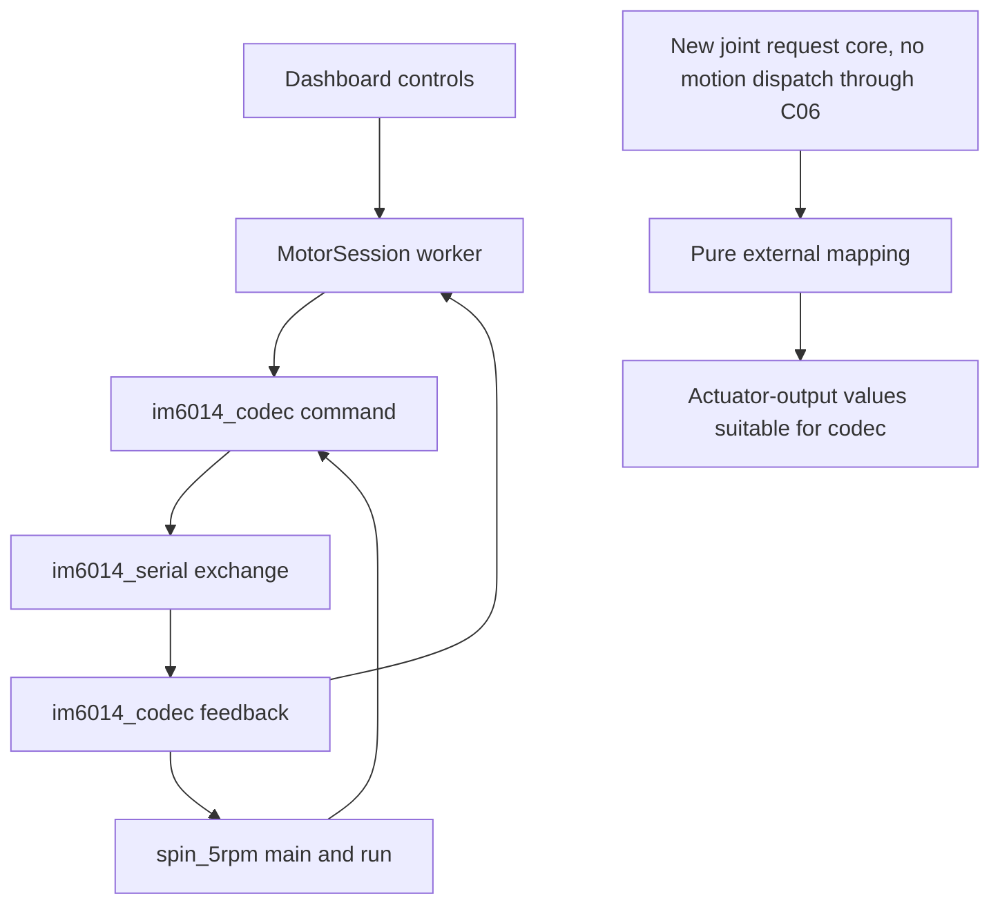

# B11-B14 and C01-C06 source grounding

## Overview

The inspected checkout is `/home/sid/Documents/code/im6014Workbench` at `d8d810888f76c676acaa1d54bc9e790249592f45`. It already has a pure actuator-output codec, a bounded serial transaction, and two bench entry points. B11-B14 add external joint conversion, stronger input boundaries, explicit adapter configuration, and useful packet records. C01-C06 add shared acquisition and a controller request core with state, per-joint observations, bounded targets, and sequence ordering.

The new request core must not dispatch hardware motion in this block. Command expiry, ownership generations, and joint/reference limits belong to C07 onward. Retaining a valid target through C06 does not mean it is safe or authorized to send. The existing bounded bench lifecycle remains a separate compatibility contract. This report inspected source only; the parent owns implementation, tests, Git operations, packages, and hardware I/O.

## Existing dependency and transaction flow



[`Dashboard.__init__`](/home/sid/Documents/code/im6014Workbench/motor_dashboard.py:85) constructs `MotorSession()` and starts display refresh. [`MotorSession.__init__`](/home/sid/Documents/code/im6014Workbench/motor_session.py:132) starts one worker with `bus=None`, state `Disconnected`, and zero packet counters. Construction and `--demo` selection do not connect. [`Dashboard.refresh_ports`](/home/sid/Documents/code/im6014Workbench/motor_dashboard.py:343) enumerates OS port metadata and resolves the saved by-id path without opening a serial port or exchanging packets.

The two real open sites are [`MotorSession._handle('connect')`](/home/sid/Documents/code/im6014Workbench/motor_session.py:270), which uses `motor_session.serial.Serial`, and [`spin_5rpm.main`](/home/sid/Documents/code/im6014Workbench/spin_5rpm.py:81), which uses `spin_5rpm.serial.Serial`. Both construct with `port=None`, set the path and inactive RTS/DTR state, then call `open()`. The GUI worker calls `_check()` after opening; Connect therefore sends Stop/status. Check, acknowledgment, Scan, Stop, and cleanup also transmit. None is a passive hardware inspection.

[`MotorSession._transact`](/home/sid/Documents/code/im6014Workbench/motor_session.py:186) calls the codec, updates transmit information, calls its module-level `exchange`, then attaches receive time, latency, source, port, baud, and connection information. It updates `last_reply` and retained telemetry only for the selected ID. [`im6014_serial.exchange`](/home/sid/Documents/code/im6014Workbench/im6014_serial.py:62) resets input once, writes once, rejects a partial write, scans for a validated requested-ID response, restores read/write settings, and checks the deadline after cleanup. `_receive()` advances one byte after a rejected frame and preserves a trailing header prefix. A recovered valid response is success; rejected CRC counts appear in a terminal deadline error rather than becoming a terminal fault for every recovered transaction.

The 50 ms default exchange deadline depends on supported synchronous driver behavior. Timeout setters, reset, I/O that ignores its timeout, and cleanup cannot be forcibly interrupted. Source inspection establishes this contract, not measured hardware latency.

## Unit conversion contract

[`im6014_codec.command`](/home/sid/Documents/code/im6014Workbench/im6014_codec.py:23) accepts actuator output-shaft position in radians, velocity in RPM, feedforward torque in Nm, and output-side gains. [`feedback`](/home/sid/Documents/code/im6014Workbench/im6014_codec.py:44) returns these output-side quantities under `position_rad`, `rpm`, and `torque_nm`. The codec owns the internal gearbox `RATIO = 38/3` and register scaling. The new external mapping must not import or apply that ratio. `DemoSerial` currently uses the ratio to simulate raw wire packets; that is fixture behavior, not an external joint mapper.

Let `N > 0` be the external reduction, `s` be exactly `+1` or `-1`, and `q0` be the actuator-output zero offset in radians. For the ideal transmission convention in [`Reduction mapping`](/home/sid/Documents/code/im6014Workbench/docs/ROBOT_WORKBENCH_AGENT_PROMPT.md:186), joint requests map to output values as follows:

```text
q_out       = q0 + s * N * q_joint
omega_out   = s * N * omega_joint
rpm_out     = omega_out * 60 / (2*pi)
tau_out     = s * tau_joint / N
kp_out      = kp_joint / N**2
kd_out      = kd_joint / N**2
```

Output feedback maps back to canonical joint state as follows:

```text
q_joint     = s * (q_out - q0) / N
omega_joint = s * (rpm_out * 2*pi / 60) / N
tau_joint   = s * N * tau_out
```

The rad/s-to-RPM conversion occurs once at this codec-facing boundary. Canonical joint state remains radians, rad/s, and joint-side Nm. Gain scaling assumes compatible stiffness and damping meanings. Round trips establish the ideal algebra for `N=1,3,6`, both signs, and nonzero offsets. They do not calibrate real direction, encoder zero, friction, backlash, compliance, or efficiency. Converting ideal torque also does not establish the physical meaning or accuracy of reported effort.

## Milestone extension points

| Unit | Existing source and required behavior |
| --- | --- |
| B11 | Put pure external mapping above `im6014_codec`, with finite mapping parameters and explicit units. Exercise both conversion directions. Keep `38/3` inside wire conversion. |
| B12 | Strengthen `command()` and `feedback()` input handling before serialization. Existing `math.isfinite()` checks cover numeric targets, but a fractional ID can pass the range predicate and fail later with `TypeError`. Require actual integer IDs 0-14, reject booleans as IDs, reject unsupported modes and malformed input types with useful errors, and check post-conversion values before packing. Reject nonfinite inputs and overflow rather than silently clipping. |
| B13 | Validate explicit adapter/path/baud configuration before either real serial constructor. Existing `_handle('connect')` checks integer ID and 4/6 Mbps; `refresh_ports()` only prioritizes the historical Channel D metadata. Prioritization does not enforce channel correctness or prove communication. Report expected versus observed channel/identity and unsupported baud from passive metadata; do not probe motors to validate configuration. Preserve disconnected startup and an explicitly supplied fixture route. |
| B14 | Extend the existing `_transact()` packet/decoded telemetry and `Dashboard.export_session()` data into bounded records that compare each raw command and reply with decoded fields and outcome. Retain ID, timing, port/baud, and physical/demo/fixture provenance. Allowlist record fields; do not dump arbitrary configuration, environment, command metadata, or credentials. Existing raw transmit data retains only the last packet; sample records contain received raw bytes. |
| C01 | Add shared acquisition to both real open sites and the new controller. Reject a second managed owner in the same process and another process, including by-id, direct-device, and other aliases resolving to the same device. Acquire ownership before serial construction/configuration, retain it for the complete open lifetime, and release it on failed opens and normal/exception cleanup. A class singleton or raw-path lock cannot meet this predicate. |
| C02 | Represent controller states explicitly and reject illegal requests before transport calls or target replacement. Preserve the bench facade's existing display strings and arm/Stop behavior. A logical Moving state in fixture checks must not create a hardware motion dispatcher. |
| C03 | Replace the new controller's single freshness value with receive time and validity for each configured joint. Only validated feedback for that ID refreshes that joint. A fresh J1 must leave missing/stale J2 visible. A valid packet with fault bits can have a fresh timestamp while remaining unhealthy; freshness and health are distinct. |
| C04 | Retain each joint's error bits, warning bits, timeout, and health result. Attribute known and unknown bits using the existing `fault_text()` behavior. Derive build status from its configured joints and disarm the affected controller/build when required. Do not invent measured states for absent joints. |
| C05 | Use one latest accepted target for the controller's configured joint vector, with an immutable snapshot or owned copy. Ten thousand updates must not create a FIFO or keep caller-mutable objects. `MotorSession.jobs` currently is an unbounded action queue, so it is unsuitable for streaming targets. Keep priority Stop/lifecycle handling separate from replaceable target storage. |
| C06 | Validate an integer sequence and require it to exceed the latest accepted sequence before atomically replacing the target. Duplicate, older, or invalid targets leave the newer accepted target intact. Define the sequence scope for the controller's request stream. Retain the sequence watermark across target clears unless an explicitly defined later ownership reset changes it. Sequence ordering alone does not provide expiry or ownership revocation. |

The preserved codec bench bounds are `0 <= kd <= 6`, `0 <= kp <= 30`, and `-3.5 <= torque <= 3.5` output Nm. Stop requires zero targets, and FOC requires the watchdog bit. B12 must not replace these bounds with the wider register capacity. `RPM_MIN/MAX` and `POSITION_MIN/MAX` describe encoding capacity and are not rated speed or safe arm travel. [`healthy`](/home/sid/Documents/code/im6014Workbench/spin_5rpm.py:18) separately applies the existing voltage, temperature, fault, timeout, measured-speed, and torque bench gates.

## Ownership, compatibility, and recovery details

The explorers' `exclusive=True` equals `TIOCEXCL` claim is false for the installed pinned pyserial 3.5. [`Serial.open`](/home/sid/Documents/code/im6014Workbench/.venv/lib/python3.12/site-packages/serial/serialposix.py:311) first calls `os.open`, then `_reconfigure_port()`. [`Serial._reconfigure_port`](/home/sid/Documents/code/im6014Workbench/.venv/lib/python3.12/site-packages/serial/serialposix.py:376) uses `fcntl.flock(fd, LOCK_EX | LOCK_NB)`. That advisory lock helps cooperating callers on the same underlying node; it does not prevent an unrelated client that ignores the lock from opening or writing. C01 needs a defined managed acquisition boundary and alias identity, plus an in-process guard independent of constructor mocks. Preserve pyserial exclusivity as an additional cooperating-port check. No software ownership mechanism here proves exclusion of every unrelated raw hardware client.

Preserve the bench aliases in [`spin_5rpm.py`](/home/sid/Documents/code/im6014Workbench/spin_5rpm.py:11), including the codec functions/constants and `exchange`. Preserve the actual `motor_session.serial.Serial`, `motor_session.DemoSerial`, and `motor_session.exchange` lookups. [`test_startup.run`](/home/sid/Documents/code/im6014Workbench/test_startup.py:230) patches all three, and [`test_startup_verifier.py`](/home/sid/Documents/code/im6014Workbench/test_startup_verifier.py:44) deliberately faults them. Merely leaving unused aliases after moving real I/O elsewhere would let startup interception miss the new path. New acquisition should accept/use those existing constructor dependencies and must not acquire/open anything on import or construction.

Keep `MotorSession.request`, `snapshot`, `ping`, and `close`, the fields consumed by the dashboard, `spin_5rpm.run(bus, args, log)`, CLI arguments, and existing failure/exit semantics. New runtime/test files must join both [`test_startup._fingerprint`](/home/sid/Documents/code/im6014Workbench/test_startup.py:112) and the baseline driver's copied-file list at [`check_offline_baseline.sh`](/home/sid/Documents/code/im6014Workbench/scripts/check_offline_baseline.sh:81). Otherwise the source used by parent checks may omit a runtime dependency or its evidence fingerprint.

[`MotorSession.request('stop')`](/home/sid/Documents/code/im6014Workbench/motor_session.py:164) increments the bench generation and signals priority Stop. `_loop()` skips queued actions from older generations. `_transact()` blocks mode-1 writes while Stop/close is pending. Explicit arm requires a healthy Stop state, setup acknowledgment, recent feedback, and a recent UI heartbeat. Arming lasts ten seconds. `_stop()`, `_fault()`, reconnect, completion, and close leave the bench disarmed. `_tick()` can keep sending Stop/status while Fault or Timeout is latched; receipt of healthy packets does not automatically restart motion. These existing bench protections are not evidence that the new core has completed C07-C16.

The timeout acknowledgment sequence is the existing application behavior. `_check(acknowledge=True)` sends watchdog-off Stop followed by watchdog-on Stop; `spin_5rpm.run()` uses explicit `--ack-timeout`. `DemoSerial.write()` models this behavior. The archived [`development notes`](/home/sid/.codex/skills/unitree-im6014/references/development-notes.md:26) document conflicting timeout-clearing descriptions and no physical resolution of that discrepancy in the archive. Do not describe this as the only possible firmware clearing method or add automatic timeout acknowledgment. Likewise, accepting a previous-mode reply during zero-torque FOC entry is a bench compatibility behavior and modeled fixture behavior, not a newly measured universal firmware fact.

The CLI's `finally` attempts up to three Stop exchanges and records unavailable confirmation; an earlier failed exchange exits the loop. It does not guarantee three successful packets or physical stopping. Stop/zero torque can release a gravity-loaded assembly. Loaded-arm hold/park/torque-disable semantics and physical commissioning remain later work.

## Evidence boundary

`DemoSerial` supplies toy unloaded dynamics. `fake_serial.FakeSerial` supplies scripted chunks, immutable write records, and `FakeClock` timing. Linux pseudo-terminal checks use actual pyserial and OS scheduling without accessing the actuator. These establish different software contracts and must keep distinct provenance. A captured physical frame used as a fixed decoder fixture remains historical evidence; decoding it now does not establish a current motor state.

The 50 ms polling condition in `_tick()` and 10 ms loop sleeps are scheduling intentions. The `rtt_ms` sample is a local transaction measurement. The explorers' assumed 1-2 ms physical transaction time and 6-12 ms six-joint cycle are unsupported. The archived notes provide a wire-only lower bound and explicitly exclude turnaround, firmware, USB, and OS delays. C15 requires actual timing measurements later. B11-C06 software results cannot establish physical mapping, a loaded-arm Stop procedure, calibrated effort, a six-joint rate, or hardware motion safety.

This grounding reconciles `/tmp/pstack-b11-c06-20261007-1mwdi1cr/how-protocol-output.md` and `how-controller-output.md` against the linked production source, startup interception, copied-source lists, pinned pyserial source, and archived Unitree notes. No implementation or tests were performed by this worker.
